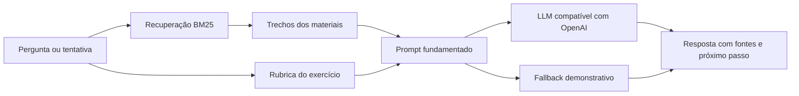

# Tutor de Algoritmos com RAG

MVP de um tutor educacional que consulta materiais da disciplina, responde com
fontes e oferece feedback formativo para tentativas de exercícios.

O projeto começou como um experimento em Google Colab com o
`Qwen2.5-Coder-7B-Instruct-AWQ`. Esta versão transforma o notebook em uma
aplicação Streamlit modular e prepara a base para incorporar os materiais reais
da disciplina.

## Demonstração

A aplicação possui três áreas:

- **Visão geral:** apresenta a proposta e o fluxo do sistema;
- **Tutor:** recupera trechos dos materiais e responde mostrando as fontes;
- **Exercícios:** analisa código com uma rubrica, destaca acertos e sugere o
  próximo passo.

Por padrão, o app abre em modo de demonstração e não exige credenciais. Nesse
modo, a recuperação é real e a resposta é extrativa. Um endpoint de Chat
Completions compatível com OpenAI pode ser configurado para habilitar a geração.

## Arquitetura



```text
chatbot-algoritmos/
├── app_pages/               # Páginas Streamlit
├── services/                # RAG, LLM e feedback
├── data/
│   ├── materiais/           # Base didática demonstrativa
│   ├── exercicios.json      # Questões e rubricas
│   └── evals/               # Casos de avaliação do retrieval
├── scripts/                 # Avaliação reproduzível
├── tests/                   # Testes unitários
├── streamlit_app.py         # Entrada da aplicação
└── chatbot_algoritmos_qwen-2.ipynb
```

## Executar localmente

Recomendado: Python 3.11 ou superior.

```bash
python -m venv .venv
source .venv/bin/activate
pip install -r requirements.txt
streamlit run streamlit_app.py
```

O Streamlit mostrará o endereço local da aplicação no terminal.

## Conectar um modelo

Copie `.env.example` para um arquivo de configuração do seu ambiente e defina:

```bash
export LLM_API_URL="http://localhost:1234/v1/chat/completions"
export LLM_MODEL="nome-do-modelo"
export LLM_API_KEY="opcional-para-servidores-locais"
```

O endpoint deve aceitar o formato Chat Completions. Isso permite usar um servidor
local, como LM Studio, ou um provedor remoto sem acoplar a interface a uma marca
específica. Segredos nunca devem ser adicionados ao Git.

## Adicionar materiais

Coloque arquivos `.md` ou `.txt` em `data/materiais`. Cada título Markdown (`#`,
`##` ou `###`) cria um trecho recuperável e identificável como fonte.

A versão atual usa BM25 como baseline local: é rápida, transparente e não exige
download de modelos. A interface `BM25Retriever.search()` foi isolada para
permitir a futura substituição por embeddings multilíngues e busca vetorial.

## Avaliação

Execute os testes e a avaliação de recuperação:

```bash
python -m unittest discover -s tests -v
python scripts/evaluate_retrieval.py
```

A avaliação calcula `Hit@3` e `MRR` em perguntas pequenas com fonte esperada. O
objetivo é tornar a qualidade da recuperação verificável, em vez de avaliar
somente tempo e quantidade de tokens.

## Decisões de escopo

- O código do aluno **não é executado** nesta versão; a análise é estática.
- O feedback não atribui nota e não deve ser usado como decisão acadêmica final.
- O conteúdo em `data/materiais` é demonstrativo e deve ser substituído pelos
  materiais revisados pelo professor.
- O modo sem LLM é intencional: permite avaliar a interface e o retrieval sem
  expor chaves ou depender de um serviço externo.
- O notebook original e o relatório foram preservados como histórico da prova de
  conceito.

## Próximos passos

1. Importar os materiais reais do semestre, incluindo PDFs e slides;
2. adicionar embeddings multilíngues e busca híbrida;
3. criar um conjunto de avaliação revisado pelo professor;
4. executar código em sandbox com testes públicos e ocultos;
5. registrar feedback dos alunos para melhorar as rubricas;
6. preparar uma demonstração publicada e um vídeo curto do fluxo.

## Autores do protótipo original

- Luis Felipe Pereira de Paiva Pordeus
- Rubens Alexandre de Sousa Ferreira
