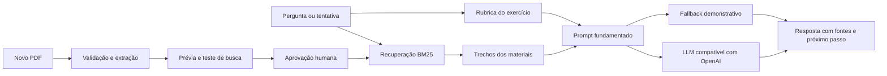

# Tutor de Algoritmos com RAG

MVP de um tutor educacional que consulta materiais da disciplina, responde com
fontes e oferece feedback formativo para tentativas de exercícios.

O conteúdo acompanha a ementa de **Algoritmos e Programação I**. A etapa atual
prioriza o raciocínio e a escrita de algoritmos em **Portugol**, preparando a
transição dos mesmos fundamentos para a linguagem **C**.

O projeto começou como um experimento em Google Colab com o
`Qwen2.5-Coder-7B-Instruct-AWQ`. Esta versão transforma o notebook em uma
aplicação Streamlit modular fundamentada nos materiais de apoio e nas listas de
exercícios elaborados para a disciplina.

O projeto foi desenvolvido durante minha atuação como **monitor de Algoritmos e
Programação I**. Os materiais de apoio e as listas de exercícios que fundamentam
a base de conhecimento e as atividades do MVP foram elaborados por mim para uso
na disciplina.

## Acesso ao MVP

**[Abrir demonstração ao vivo →](http://13.217.22.43)**

A versão pública está hospedada em uma instância EC2 do AWS Academy Learner Lab
e funciona em modo somente leitura. Por ser uma implantação acadêmica temporária,
o endereço usa HTTP e pode ficar indisponível quando o laboratório ou a instância
estiverem desligados.

## Funcionalidades

A aplicação possui quatro áreas:

- **Visão geral:** apresenta a proposta e o fluxo do sistema;
- **Tutor:** recupera trechos dos materiais e responde mostrando as fontes;
- **Exercícios:** reúne as 20 questões da Lista 001, analisa Portugol com uma
  rubrica, destaca acertos e sugere o próximo passo;
- **Gerenciar materiais:** valida um PDF, mostra a extração, testa a recuperação
  e só atualiza a base depois de uma aprovação humana.

Por padrão, o app abre em modo de demonstração e não exige credenciais. Nesse
modo, a recuperação é real e a resposta é extrativa. Um endpoint de Chat
Completions compatível com OpenAI pode ser configurado para habilitar a geração.

## Arquitetura



```text
chatbot-algoritmos/
├── app_pages/               # Páginas Streamlit
├── services/                # RAG, LLM e feedback
├── data/
│   ├── materiais/           # Conteúdo recuperável dos materiais 01, 02 e 03
│   ├── materials_manifest.json # Histórico e hashes das ingestões automáticas
│   ├── exercicios.json      # 20 questões da Lista 001 e suas rubricas
│   └── evals/               # Casos de avaliação do retrieval
├── scripts/                 # Avaliação reproduzível
├── deploy/                  # Inicialização reproduzível da EC2
├── tests/                   # Testes unitários
├── Dockerfile               # Imagem para execução em cloud
├── streamlit_app.py         # Entrada da aplicação
├── ui.py                    # Tema e componentes visuais compartilhados
└── chatbot_algoritmos_qwen-2.ipynb
```

## Executar localmente

Recomendado: Python 3.11 ou superior.

```bash
python -m venv .venv
source .venv/bin/activate
pip install -r requirements.txt
streamlit run streamlit_app.py
```

O Streamlit mostrará o endereço local da aplicação no terminal.

## Executar com Docker

```bash
docker build -t chatbot-algoritmos .
docker run --rm -p 8501:8501 chatbot-algoritmos
```

O container inclui um health check no endpoint `/_stcore/health`. Para uma
demonstração pública, use `-e APP_READ_ONLY=true` para impedir que visitantes
alterem a base de conhecimento.

## Implantação demonstrativa na AWS

O arquivo `deploy/aws-ec2-user-data.sh` prepara uma instância Amazon Linux 2023,
instala Docker, clona a branch `main` e publica o Streamlit na porta HTTP 80. A
versão pública inicia em modo somente leitura e mantém Tutor, Exercícios e a
visualização do pipeline de materiais disponíveis.

Configuração mínima sugerida para a demonstração:

- EC2 Amazon Linux 2023, arquitetura `x86_64`;
- tipo de instância de baixo custo compatível com o Learner Lab;
- 8 GB de volume EBS;
- Security Group com HTTP 80 aberto para a internet;
- sem chaves ou segredos de LLM na imagem.

O ambiente do Learner Lab é temporário. O endereço público e os recursos devem
ser tratados como demonstração acadêmica, não como hospedagem permanente.

## Conectar um modelo

Copie `.env.example` para um arquivo de configuração do seu ambiente e defina:

```bash
export LLM_API_URL="http://localhost:1234/v1/chat/completions"
export LLM_MODEL="nome-do-modelo"
export LLM_API_KEY="opcional-para-servidores-locais"
```

O endpoint deve aceitar o formato Chat Completions. Isso permite usar um servidor
local, como LM Studio, ou um provedor remoto sem acoplar a interface a uma marca
específica. Segredos nunca devem ser adicionados ao Git.

## Adicionar materiais

Use a página **Gerenciar materiais** para enviar um PDF. A automação valida o
arquivo, extrai o texto por página, bloqueia duplicatas pelo hash SHA-256 e
permite testar a recuperação antes de confirmar. O PDF original não é salvo: só
a versão textual aprovada é gravada em `data/materiais`, acompanhada de um
registro em `data/materials_manifest.json`.

Também é possível colocar arquivos `.md` ou `.txt` manualmente em
`data/materiais`. Cada título Markdown (`#`, `##` ou `###`) cria um trecho
recuperável e identificável como fonte.

A versão atual usa BM25 como baseline local: é rápida, transparente e não exige
download de modelos. A interface `BM25Retriever.search()` foi isolada para
permitir a futura substituição por embeddings multilíngues e busca vetorial.

## Conteúdo da disciplina

A base atual cobre:

- lógica de programação, planejamento e decomposição de problemas;
- descrição narrativa, fluxograma e pseudocódigo;
- estrutura de um algoritmo em Portugol;
- variáveis, tipos de dados, declaração e atribuição;
- entrada, processamento e saída;
- estrutura sequencial;
- exercícios de expressões aritméticas, conversões, porcentagens e custos.

## Avaliação

Execute os testes e a avaliação de recuperação:

```bash
python -m unittest discover -s tests -v
python scripts/evaluate_retrieval.py
```

A avaliação calcula `Hit@3` e `MRR` em perguntas pequenas com fonte esperada. O
objetivo é tornar a qualidade da recuperação verificável, em vez de avaliar
somente tempo e quantidade de tokens.

## Próximos passos

1. Adicionar OCR opcional para materiais escaneados;
2. Criar exercícios equivalentes em C quando essa linguagem for introduzida;
3. Adicionar embeddings multilíngues e busca híbrida;
4. Ampliar o conjunto de avaliação revisado pelo professor;
5. Integrar um interpretador de Portugol ou uma sandbox segura para C;
6. Preparar uma demonstração publicada e um vídeo curto do fluxo.
